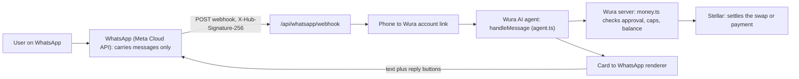

# WhatsApp

Wura should be reachable on WhatsApp, as the same assistant as on the web: the same commands, the same quote before anything moves, the same approval, limits and log. This note explains what we are asking the implementer to build, what we need to bring to set it up, which provider to use, what it costs, and the policy risk to check before production.

Nothing here is built yet. The web app shows WhatsApp only as a “connected app” label. Research was done in November 2026 from Meta's docs and policy pages, provider pricing pages and Nigerian setup guides (sources at the end). Several of those are third-party write-ups; check Meta's own pages before relying on a figure.

## Summary

- **WhatsApp is only a message channel.** It carries the user's text to Wura and Wura's replies back. It does not swap, send, hold or price money, and it never sees a wallet key.
- **Wura's AI agent does the work.** It reads what the user wrote, works out what they want, gets a quote and asks for approval. It is the same agent the web chat uses, so WhatsApp gets exactly the same checks.
- **Wura's server and Stellar move the money**, and only after the user approves. Balances, approvals, limits and the transaction log all live on Wura's server.
- **What we are asking for** is a WhatsApp adapter: a webhook that receives WhatsApp messages and passes them to the existing agent, a renderer that turns the agent's replies into WhatsApp messages and buttons, and a secure way to link a WhatsApp number to a Wura account. No new money logic, and no separate AI for WhatsApp.
- **For the buildathon:** use the **Meta WhatsApp Cloud API directly**, with Meta's **free test number**. It needs no business verification and costs nothing. Its limit is that it can only message up to **5 phone numbers we verify in advance**, which is enough for a team demo but not for judges trying it on their own phones.
- **For production:** a verified business, a real number, a payment method, approved message templates, and an answer from Meta on the currency policy. The policy question is about what Wura's chat is used for, not about WhatsApp handling money (see [Policy risk](#policy-risk)). It comes first, because it can block the channel entirely.

## How the pieces fit

| Part | What it does | What it does not do |
| --- | --- | --- |
| **WhatsApp** (Meta Cloud API) | Delivers the user's message to Wura's webhook, and delivers Wura's reply and buttons to the user | Understand requests, quote, approve, hold or move money |
| **Wura's AI agent** (`handleMessage` in `web/src/server/agent.ts`) | Understands the request, gets a quote or preview, asks the user to approve, explains refusals | Move money on its own. It only returns a quote or preview |
| **Wura's server** (`web/src/server/money.ts`) | Checks ownership, quote expiry, the per-payment cap, the daily cap and the balance, then carries out the approved action and writes the log | Act without an approval |
| **Stellar** | Settles the swap or payment | |

A swap over WhatsApp, step by step:

1. The user types “Change ₦50,000 to dollars” in WhatsApp.
2. WhatsApp delivers the message to Wura's webhook.
3. Wura's agent understands it, gets quotes from the venues and builds a quote card.
4. Wura sends the quote back through WhatsApp, with Approve and Cancel buttons.
5. The user taps Approve. WhatsApp delivers the tap to the webhook, like any other message.
6. Wura's server runs the same checks as on the web, and the swap settles on Stellar.
7. Wura sends a receipt back through WhatsApp. The same entry appears in the web transaction log.

Today the agent is a small rule-based parser. The plan is to replace it with a language model that calls the same typed money functions (see the comment at the top of `agent.ts`). That swap happens once, inside the agent, and every channel benefits. The WhatsApp code should never need to change for it.

## Policy risk

WhatsApp doesn't handle Wura's money, but Meta's rules still apply to what a business *uses WhatsApp for*. Two rules matter.

### Currency and crypto

WhatsApp's Business Policy prohibits using WhatsApp for Business for “buying, selling, promoting, or otherwise facilitating the exchange of … real, virtual, or fake currency, including ICOs and binary options”. It adds that these prohibitions “apply irrespective of the global or local licenses, registrations, or other approvals your business may hold”. Meta's enforcement list names the violation `REAL_FAKE_CURRENCY`.

This rule is about the business, not about WhatsApp. It doesn't say WhatsApp must be the one moving money. It says a business must not use its WhatsApp account to facilitate currency exchange, and Meta judges that by what the conversation is for, not by where the money settles. A user asking Wura's agent for a swap in chat and tapping Approve is Wura taking a currency-exchange order over WhatsApp, even though the swap itself happens on Stellar. It's the same reason a liquor shop can't take orders on WhatsApp, even though the bottle is delivered by hand.

So, on a plain reading, Wura's use of WhatsApp falls under this rule. Several Nigerian stablecoin bots run on WhatsApp anyway (see [Competitors](competitors.md), especially Chainpaye), so enforcement is clearly discretionary. But Meta can restrict or disable a number without warning, appeals are slow, and a ban can extend to future use of WhatsApp products by the same business.

What to do about it:

- **Ask before production.** Put the question to Meta directly, or through a Business Solution Provider such as 360dialog, with a plain description: WhatsApp is only the chat channel, and swaps and payments are carried out by Wura's server on Stellar after the user approves. Record the answer in [Open questions](open-questions.md).
- **Run it as customer service for Wura's own users**, not as a sales channel for crypto. No marketing templates that promote tokens, rates or swaps to people who haven't asked.
- **Keep the web app as the source of truth.** Every balance, approval and log entry lives on Wura's server. If the WhatsApp number is lost, nothing else breaks.
- **Keep Telegram as the fallback channel.** Telegram bots need no business approval: a bot is created with @BotFather in minutes, and the Bot API is free.

### AI assistants

Since 15 January 2026, WhatsApp's Business Platform terms bar “AI Providers” from offering a general-purpose AI assistant as the main thing they make available on WhatsApp. Meta said at the time that businesses using AI to serve their own customers are not affected.

Using AI to understand messages is fine. Wura is a money service that uses AI to serve its own users, not an AI company offering a general-purpose assistant, so it is not the target of this rule. This holds whether the agent is today's rule-based parser or a language model, as long as it stays scoped to money: it calls the same typed money functions, only answers money questions, and politely refuses everything else. Don't let it become an open-ended chatbot on WhatsApp.

### Messaging rules we must follow

- **Opt-in.** We may only message people who have opted in to hear from Wura. Record that consent.
- **A way to reach a human.** The Business Messaging Policy allows automated replies inside the 24-hour window only with a “prompt, clear, and direct” escalation path: a support email, a web support page, a form, or a hand-off to a person.
- **Nigeria's data protection law (NDPA 2023).** Ask for WhatsApp consent separately from other consent, and give a clear way to opt out.
- **Never ask for a NIN in WhatsApp.** The identity check stays on the web, as described in [KYC and funding](kyc-and-funding.md).

## Choosing a provider

The provider only delivers messages. Twilio and 360dialog are not different products: all three options reach the same Meta Cloud API and pay the same Meta per-message fees. What changes is what sits on top, and who helps when something goes wrong.

| Option | Extra cost on top of Meta | Getting started | Best for |
| --- | --- | --- | --- |
| **Meta Cloud API, direct** | None | Free test number, 5 test recipients | Developers who can build the webhook themselves. Recommended |
| **Twilio** | About $0.005 per message, sent and received | Sandbox needs no WhatsApp Business account; trial includes 100 WhatsApp messages | Teams already on Twilio |
| **360dialog** | Flat fee from about €49 a month, no per-message markup | Onboarding through the partner | A partner to help with verification and templates |

Notes:

- **Meta direct** gives no dashboard or support line beyond Meta's own channels, which are slow for small accounts. For a team that writes its own webhook, that's the only real downside, and it's free.
- **Twilio's sandbox** is quick, but only phones that text a join code can use it, only a small set of test templates is allowed, and Twilio says not to use it in production. Moving off it later means re-wiring to Twilio's message format.
- **360dialog** is worth it later if business verification or template approval gets stuck and we need a partner to push it through. It does not protect us from a policy ban.
- **Telegram** is the fallback channel, not a WhatsApp provider. It's free and has no approval process.

**Recommendation:** Meta Cloud API direct for the buildathon and early pilots. Revisit 360dialog if verification stalls.

## What we need to bring

### For the buildathon demo

| Item | Where it comes from | Notes |
| --- | --- | --- |
| Facebook account | Any team member | Must have full control of the business portfolio below |
| Meta Business Portfolio | business.facebook.com | Can stay unverified for the demo |
| Meta developer app (Business type) with the WhatsApp product | developers.facebook.com | Creating it also creates a WhatsApp Business Account (WABA) |
| Free test phone number | Created automatically by Meta | Sends only to the 5 verified recipients below |
| Up to 5 recipient phone numbers | WhatsApp > API Setup | Each person confirms with a code from Meta. Choose the presenter's phone and team phones |
| WABA ID and Phone Number ID | WhatsApp > API Setup | Copy both |
| Temporary access token | WhatsApp > API Setup | Expires in under 24 hours. Fine for a first test only |
| Permanent access token | Business Settings > System users | Create a system user, assign it the app and the WABA with full control, then generate a token with `business_management`, `whatsapp_business_messaging` and `whatsapp_business_management` |
| App Secret | App settings > Basic | Used to check that webhook calls really come from Meta |
| Verify token | We choose it | Any long random string; Meta sends it back when we register the webhook |
| Public HTTPS webhook URL | The Vercel deploy, or a cloudflared / ngrok tunnel for local work | Register it in the app and subscribe to the `messages` field |
| A database | Postgres (Neon via Vercel) | The in-memory store resets between Vercel instances, so a webhook would lose quotes between messages. Merge the `persistence` branch first |

New environment variables (server-side only, never `NEXT_PUBLIC_`):

```bash
# Meta WhatsApp Cloud API. All empty = WhatsApp is off.
WHATSAPP_ACCESS_TOKEN=          # system user token
WHATSAPP_PHONE_NUMBER_ID=       # the number Wura sends from
WHATSAPP_BUSINESS_ACCOUNT_ID=   # WABA ID, used for templates
WHATSAPP_APP_SECRET=            # checks X-Hub-Signature-256 on webhooks
WHATSAPP_VERIFY_TOKEN=          # our own random string for the webhook handshake
WHATSAPP_GRAPH_VERSION=         # e.g. v26.0; use the latest version in Meta's docs
```

### For production

- **A dedicated phone number.** It must be one we own, with a country and area code (no short codes), able to receive an SMS or voice code, and not already registered on WhatsApp. It gets a two-step verification PIN when registered. A Nigerian +234 SIM bought for Wura is the simplest choice.
- **Business verification** in Meta Business Suite (Settings > Security Center). Meta says it can take up to 14 business days, and it often asks for a second document. Enter the legal name exactly as it appears on the documents. Nigerian documents that usually work:
  - **Legal name:** CAC Certificate of Incorporation (RC number) for a limited company, or CAC certificate of registration of a business name (BN number).
  - **Supporting:** a recent CAC status report, or a TIN certificate in the business's name.
  - **Address or phone:** a utility bill or business bank statement in the business's name. These never prove the legal name on their own.
  - **Website:** a live site on our own domain showing the registered name and contact details, plus an email address on that domain.
- **A display name Meta accepts.** It must clearly relate to the legal business name and match our branding elsewhere. No generic words, no “Official”, no promotional wording, no website address. If the company isn't called Wura, the link between the two names has to be visible on our website.
- **A payment method** in Meta's Billing Hub. Without one, Meta stops delivering service messages once the free 1,000 a month are used.
- **Approved message templates** for anything Wura sends outside the 24-hour window, such as “You received 20.00 USDC” or “Your payment link was paid”. These should be **utility** templates. Meta reviews each one.
- **A support contact** for the escalation path: an email address and a support page on the website.

## Costs

These are Meta's fees for delivering messages. They are separate from swap and network fees, which Wura's quotes already show. Meta charges per delivered message, in US dollars, by message type and the recipient's country. Nigeria (+234) rates, from Meta's rate card effective 1 October 2026:

| Message | Rate per message | Notes |
| --- | --- | --- |
| From the user to Wura | Free | Always |
| Service reply (inside the 24-hour window) | First 1,000 a month free per number, then $0.0067 | Most of Wura's traffic |
| Utility template | $0.0067 | Receipts and notifications outside the window |
| Authentication template | $0.0067 | Not needed: sign-in stays on the web |
| Marketing template | $0.0516 | Avoid; see the policy section |

Messaging limits apply to conversations *Wura starts*, not replies. An unverified business can start conversations with 250 people a day; a verified one, 2,000, rising with good quality ratings. Replies to people who message Wura are unlimited.

For the buildathon, the free test number and the free 1,000 service messages mean the WhatsApp cost is zero. Twilio would add about $0.005 per message in each direction, and 360dialog a monthly fee from about €49.

## How it plugs into Wura's code

This is a design, not something built yet. The goal is to reuse the existing agent and money API unchanged, so WhatsApp gets exactly the same checks as the web. Everything new is in the WhatsApp adapter: receiving messages, linking numbers, and formatting replies.



### The webhook

A new route, `/api/whatsapp/webhook`:

- **GET:** Meta's one-time handshake. If `hub.verify_token` matches `WHATSAPP_VERIFY_TOKEN`, echo back `hub.challenge`.
- **POST:** each incoming message.
  1. Read the raw body first. The signature covers the exact bytes, so parse JSON only after checking it.
  2. Compute HMAC-SHA256 of the raw body with `WHATSAPP_APP_SECRET` and compare it, in constant time, with the `X-Hub-Signature-256` header (after `sha256=`). Reject anything that doesn't match.
  3. Skip message IDs (`wamid`) we've already handled. Meta retries, and a retried “Approve” must not run twice.
  4. Always answer 200 once the request is genuine. Meta keeps retrying failed deliveries for days.

### Reuse, not rewrite

- Pass the text to `handleMessage` from `web/src/server/agent.ts` as it is. It already returns plain text plus an optional card, and it never moves money itself. Don't add a second parser or AI for WhatsApp.
- Add a renderer that turns each `AgentCard` type (`web/src/lib/types.ts`) into a WhatsApp message:
  - `quote`: the venues as lines (“Aquarius 31.20 USDC, best”), the rate, the fee, and Approve / Cancel buttons.
  - `send`: recipient, amount, fee, daily limit left, per-payment cap, and Confirm / Cancel buttons.
  - `link`: the amount and the link as text, which WhatsApp makes tappable.
  - `balance` and `rates`: plain text.
  - `refused`: the reason, in plain text.
  - `site-permission` and `site-action`: leave out of WhatsApp for now. Site connect is a stretch skill on the web.
- Reply buttons: at most 3 per message, labels up to 20 characters, and an ID up to 256 characters that comes back when tapped. Use IDs such as `swap:approve:<quoteId>` and `send:cancel:<intentId>`, and route on the ID, never on the label.

### Linking a WhatsApp number to a Wura account

A phone number on its own must never be enough to reach someone's money.

1. The user signs in on the web with their email code, as today.
2. On the Channels page, they tap “Connect WhatsApp”. Wura shows a short one-time code and a `wa.me` link that opens a chat with the code already typed.
3. They send it. The webhook checks the code, then stores the link from that phone number to their Wura user.
4. Until a number is linked, the bot only explains how to link it. It never looks people up by email inside the chat.

### Approval and signing

An Approve tap is a message like any other. WhatsApp delivers it; Wura's server decides whether to act.

- **Mock mode:** tapping Approve calls the same `approveSwap` / `createSend` with `approve: true`. The server still checks ownership, expiry, both caps and the balance, exactly as on the web.
- **Testnet with Privy:** the user's Privy wallet signs in the browser, which a WhatsApp chat can't do. Instead of Approve, send a **link button** (Meta calls this a CTA URL message) that opens Wura's web app on that exact preview, where the user approves and signs as they do today.
- **Later:** the scoped session key described in [Auth](auth.md) and in `web/src/server/signer.ts`. It lets the server sign approved, in-limit actions without a browser, and refuses anything over the caps. The longer-term version is the on-chain agent key in [Wallet roadmap](wallet-roadmap.md).
- Passkeys often fail inside WhatsApp's in-app browser. Anything that needs a passkey should open the phone's real browser (see [Wallet roadmap](wallet-roadmap.md)).

### WhatsApp limits to design around

- **The 24-hour window.** Free-form replies and buttons only work within 24 hours of the user's last message. After that, only approved templates can be sent, and an interactive send fails with error 131047.
- **Link buttons don't report taps.** Tapping a CTA URL button doesn't send a webhook. If we need to know who opened it, put a one-time reference in the URL and read it on our page.
- **Quotes expire after 60 seconds** (`quoteTtlMs` in `web/src/server/config.ts`). A tap on an old Approve button will be refused by the server; the bot should reply “That quote expired. Ask again and I'll get a fresh rate.”
- **One button tap is one message.** It resets the 24-hour window, and it's free to receive.

## Buildathon demo path

On a team phone that is one of the 5 test recipients:

1. Link the number: send the one-time code from the web Channels page.
2. Send “Change ₦50,000 to dollars”. Wura's agent replies with the three venues, the best one marked, and Approve / Cancel.
3. Tap Approve. Wura's server carries out the swap and the agent replies with a receipt and the reference.
4. Send “Send $20 to Tunde”. Wura replies with the preview, the daily limit left and the per-payment cap, and Confirm / Cancel.
5. Send “Send $60 to Tunde”. Wura refuses: it's over the per-payment cap.
6. Open the web dashboard and show the same entries in the transaction log. This shows that WhatsApp was only the channel: the actions happened on Wura's server.

If a judge wants to try it on their own phone, their number has to be added as a test recipient first (5 maximum), or the demo has to use a verified production number.

## Open questions

- **Currency policy.** WhatsApp doesn't move Wura's money, but Meta's rule covers businesses that use WhatsApp to facilitate currency exchange. Will Meta accept a business whose WhatsApp chat is used to request naira and USDC swaps that Wura carries out on Stellar? Ask Meta or a Business Solution Provider before production.
- **AI for the demo.** Whether the buildathon demo uses today's rule-based agent or a language model calling the same money functions. Either way it lives in `agent.ts`, not in the WhatsApp code.
- **Legal entity.** Which registered business verifies with Meta, and does its name link clearly to “Wura” for the display name?
- **Phone number.** Which dedicated number Wura uses in production.
- **Demo reach.** Is the test number's 5-recipient limit enough for the showcase, or do we need a verified number before 4 December?

These are also listed in [Open questions](open-questions.md).

## Sources

Meta, official (checked November 2026):

- Cloud API get started (test number, system user token): https://developers.facebook.com/docs/whatsapp/cloud-api/get-started/
- Business phone numbers (eligibility, registration, two-step PIN): https://developers.facebook.com/documentation/business-messaging/whatsapp/business-phone-numbers/phone-numbers
- Pricing (per-message rates, free tier of 1,000 service messages from 1 October 2026): https://developers.facebook.com/documentation/business-messaging/whatsapp/pricing
- Interactive reply buttons: https://developers.facebook.com/docs/whatsapp/cloud-api/messages/interactive-reply-buttons-messages/
- Interactive messages and the 24-hour window: https://developers.facebook.com/docs/whatsapp/guides/interactive-messages/
- Webhook payload signatures (`X-Hub-Signature-256`): https://developers.facebook.com/docs/graph-api/webhooks/getting-started/
- Policy violations, including `REAL_FAKE_CURRENCY`: https://developers.facebook.com/documentation/business-messaging/whatsapp/policy-enforcement-violations/
- WhatsApp Business Policy: https://whatsappbusiness.com/policy/
- WhatsApp Business Platform terms (AI Providers clause): https://www.whatsapp.com/legal/WhatsApp-Terms-for-WhatsApp-Business-Platform
- Partner-led business verification (250 vs 2,000 limits): https://www.facebook.com/business/help/995114135706133

Providers:

- Twilio WhatsApp pricing: https://www.twilio.com/en-us/whatsapp/pricing
- Twilio WhatsApp sandbox: https://www.twilio.com/docs/whatsapp/sandbox
- Twilio vs 360dialog vs direct Cloud API (third-party comparison): https://wahttp.com/blog/twilio-vs-360dialog-vs-direct-cloud-api

Reporting and guides (third-party, not a substitute for Meta's pages):

- TechCrunch on the general-purpose chatbot ban: https://techcrunch.com/2025/10/18/whatssapp-changes-its-terms-to-bar-general-purpose-chatbots-from-its-platform/
- What Meta's AI rule allows: https://setscale.io/blog/whatsapp-ai-chatbot-what-meta-allows
- WhatsApp rules for finance businesses: https://connect.bitbytecore.com/guides/whatsapp-for-a-finance-business-what-metas-rules-say-about-lending-currency-card-numbers-codes-and-ai-agents
- Nigeria rates in naira: https://irokodigital.com/blog/whatsapp-business-api-pricing-nigeria
- Nigerian CAC documents for Meta verification: https://broadchat.in/ng/guides/get-whatsapp-business-api-nigeria and https://wazy.africa/guides/how-to-get-whatsapp-business-api-in-nigeria/
- Display name rules: https://conecxt.com/resources/meta-business-verification-whatsapp/
- WhatsApp vs Telegram bots: https://cloudlesslabs.com/stack/guides/whatsapp-or-telegram/
